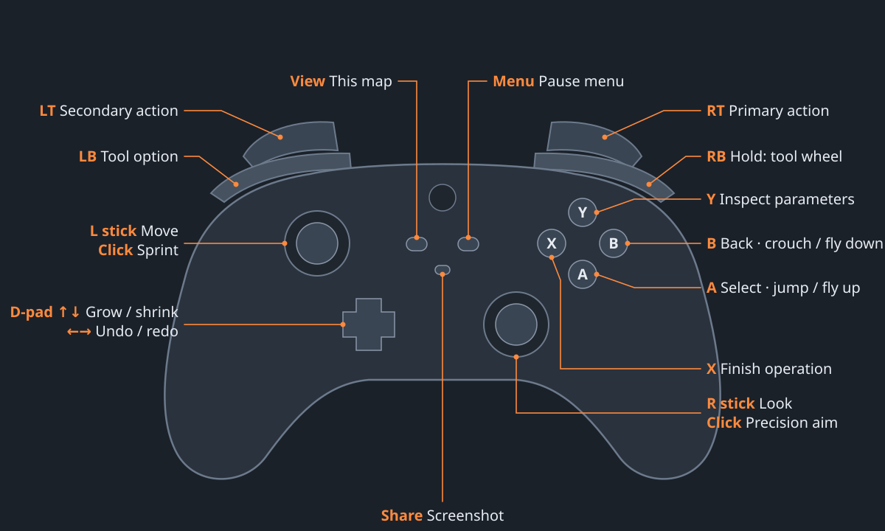

# FPS-CAD

Parametric CAD you play in first person. Walk around your model, change your own size to zoom,
and pick tools from a weapon wheel. Built for an Xbox controller on Windows PC and Android, with
keyboard and mouse as an equal on PC. Everything runs locally: no accounts, servers or network.

Parts and assemblies keep their full editable history in native files (`.fpprt`, `.fpasm`) and
export to STEP, IGES, STL and 3MF.

> Status: **Phase 1 — the CAD workflow.** Pick a plane or a flat face, sketch with relations and
> dimensions, then extrude, revolve, sweep or loft, all in the part's history. Mates solving and
> drawings come in later phases. See [docs/PHASE0.md](docs/PHASE0.md) and
> [docs/SKETCHING.md](docs/SKETCHING.md).

## What is here

| Path | What it is |
| --- | --- |
| `core/` | Engine-agnostic C++17 CAD core on Open CASCADE: parametric features, expressions, rebuild, picking, push/pull, native files, exports |
| `core/cli/` | `fpcad` command-line tool: create samples, inspect, edit parameters, export |
| `core/tests/` | Headless tests, including export read-back validation |
| `extension/` | Godot 4 GDExtension exposing the core as `CadPart` and `CadAssembly` |
| `godot/` | The game: first-person player, self-scaling, tool wheel, HUD, touch controls |
| `prototypes/web-v1/` | The original browser prototype |
| `docs/` | Engineering spec summary, build guide, Phase 0 checklist |
| `tools/` | Open CASCADE build and staging scripts |

The full product spec is the shared doc **First-Person CAD — Product Spec**;
[docs/SPEC.md](docs/SPEC.md) pins the decisions the code depends on.

## Quick start (Linux or Windows)

```bash
tools/build_occt.sh "$HOME/occt" linux          # once, about 30–60 minutes
cmake -S . -B build -G Ninja -DCMAKE_PREFIX_PATH="$HOME/occt" -DFPCAD_BUILD_EXTENSION=ON
cmake --build build
ctest --test-dir build --output-on-failure      # LD_LIBRARY_PATH=$HOME/occt/lib on Linux
python3 tools/stage_occt.py --occt "$HOME/occt" --platform linux
godot --path godot                              # Godot 4.5 or newer
```

Full instructions, including Windows and Android: [docs/BUILDING.md](docs/BUILDING.md).

## Controls

New players start with **Training** on the title screen: a fourteen-step course that teaches
moving, jumping, shrinking through a 30 cm tunnel, the tool wheel, push/pull, sketching a
rectangle on a face, finishing the sketch, extruding it, measuring and the controls map.
**New part** opens a blank part with the Sketch tool ready. Press View (F1) at any time for the full map:



| Xbox controller | Keyboard and mouse | Action |
| --- | --- | --- |
| Left stick | WASD | Move (L3 toggles sprint; Shift sprints) |
| Right stick | Mouse | Look (R3 / Alt: precision aim) |
| RT / LT | Left / right click | Tool primary / secondary action |
| Hold RB | Hold Q | Tool wheel |
| LB | E | Cycle the tool's option |
| D-pad ↑ / ↓ | Scroll, = / − | Grow / shrink (tap ×2, hold for smooth); R resets |
| D-pad ← / → | Ctrl+Z / Ctrl+Shift+Z | Undo / redo |
| A / B | Space / C | Jump or fly up / fly down |
| A / B | Enter / Esc | Select / back in every menu |
| Y | I, Tab | Inspect the target's parameters (model panel) |
| View | F1 | Controls map (controller, keyboard and touch pages) |
| Menu | Esc | Pause menu: controls, save, open, export, exit to title |
| — | F | Fly through walls |
| X | Enter | Finish the sketch |
| Y (sketching) | I | Sketch view ↔ free look (sketches open square to the plane, X right, Y up) |

The tool wheel groups tools: **Select**, **Sketch**, **Solids** (Extrude, Revolve, Sweep,
Loft), **Modify** (Push/Pull, Move, Delete), **Primitives** (Box, Cylinder, Sphere) and
**Measure**. Aiming at a group shows its tools branching out from it; let go (or press A) to open
the branch, then aim and press A / RT to pick. B steps back. In sketch mode the wheel holds the sketch tools: Draw, Constrain and Delete. The full sketch and feature-panel controls are
in [docs/SKETCHING.md](docs/SKETCHING.md) and on the controls map's fourth page.

## The CLI

```bash
fpcad sample pavilion.fpprt
fpcad info pavilion.fpprt
fpcad set pavilion.fpprt "Roof.h=450"            # plain numbers use the document's units
fpcad export pavilion.fpprt pavilion.step --units mm
fpcad sample-assembly pins.fpasm && fpcad export pins.fpasm pins.3mf
```

## Licences

FPS-CAD's own code: see the repository licence once chosen. Open CASCADE Technology is LGPL 2.1
with an exception and ships as separate shared libraries; see [docs/THIRD_PARTY.md](docs/THIRD_PARTY.md).
